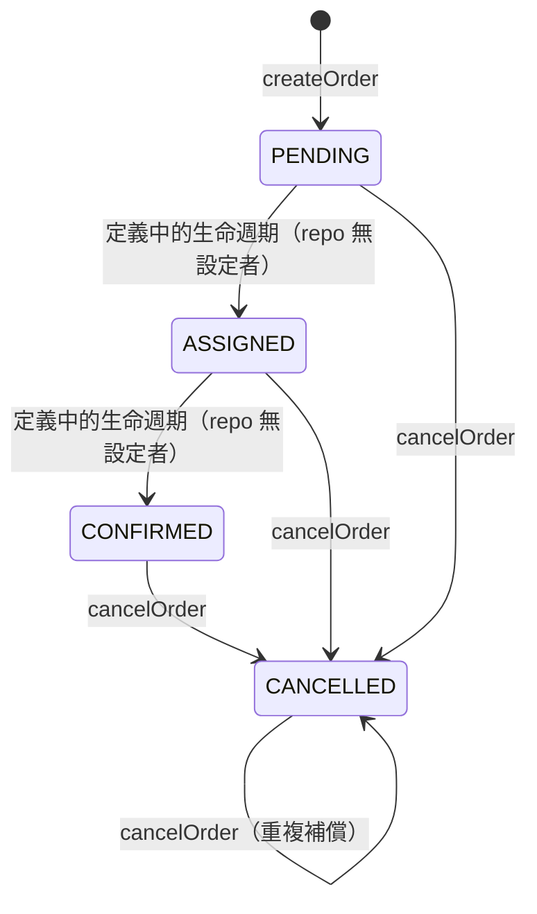

# ordering 模組：訂單建立、對外端點與取消補償

> 分析基準：`tradingbot-tw/saga-pattern` @ `975bb43`（trunk `software-factory`）。
> 本文依現行程式碼、Conductor 定義檔與測試撰寫；若與實作不符，以程式碼為準。

ordering 是系統唯一的對外入口。本文說明 `POST /triggerFoodDeliveryFlow` 的請求／回應契約、
`OrderService.createOrder` 的落地步驟與失敗訊號，以及 `cancelOrder` 作為 Saga 補償步驟的語意。
庫存、付款、外送服務的內部規則不在本文範圍。

## 元件與職責

| 元件 | 位置 | 在訂單路徑上的職責 |
| --- | --- | --- |
| `OrderServiceController` | `src/main/java/io/orkes/example/saga/controller/OrderServiceController.java:23-26` | 接收 `FoodDeliveryRequest`，原樣交給 `WorkflowService`，固定以 HTTP 200 回傳其結果 |
| `WorkflowService` | `src/main/java/io/orkes/example/saga/service/WorkflowService.java:22-60` | 組裝 workflow input、啟動 `FoodDeliveryWorkflow` v1；啟動例外時回傳 error map |
| `OrderService.createOrder` | `src/main/java/io/orkes/example/saga/service/OrderService.java:21-59` | 建立客戶與訂單，回傳 orderId；任一寫入失敗回傳 `null` |
| `OrderService.cancelOrder` | `src/main/java/io/orkes/example/saga/service/OrderService.java:67-76` | 取消訂單，回傳受影響列數 |
| `OrdersDAO` | `src/main/java/io/orkes/example/saga/dao/OrdersDAO.java:18-172` | `orders`／`orders_details`／`customers` 的 SQLite CRUD |
| `ConductorWorkers.orderFoodTask` | `src/main/java/io/orkes/example/saga/workers/ConductorWorkers.java:26-41` | `order_food` task：呼叫 `createOrder`，把 `null` 轉成 `FAILED` |
| `ConductorWorkers.cancelOrderTask` | `src/main/java/io/orkes/example/saga/workers/ConductorWorkers.java:181-196` | `cancel_order` task：把列數與例外轉成 task 狀態 |
| `Order.Status` | `src/main/java/io/orkes/example/saga/pojos/Order.java:10-15` | 訂單狀態列舉（以 `name()` 字串落地） |

## 對外端點

### 請求契約

`POST /triggerFoodDeliveryFlow`，請求與回應皆為 `application/json`
（`controller/OrderServiceController.java:23`）。請求物件為 `FoodDeliveryRequest`
（`src/main/java/io/orkes/example/saga/pojos/FoodDeliveryRequest.java:8-18`）：

| 欄位 | Java 型別 | 去向 |
| --- | --- | --- |
| `customerEmail` | `String` | workflow input `customerEmail` → `order_food` → `customers.email` |
| `customerName` | `String` | workflow input `customerName` → `order_food` → `customers.name` |
| `customerContact` | `String` | workflow input `customerContact` → `order_food` → `customers.contact` |
| `restaurantId` | `int` | workflow input `restaurantId` → `orders.restaurantId`，也用於 `check_inventory` |
| `foodItems` | `ArrayList<Object>` | workflow input `foodItems` → `order_food` 的 `items`（`OrderRequest.items` 為 `ArrayList<FoodItem>`） |
| `additionalNotes` | `ArrayList<String>` | workflow input `additionalNotes` → `order_food` 的 `notes` → `orders_details.notes` |
| `address` | `String` | workflow input `address` → `order_food` 的 `deliveryAddress` → `orders.deliveryAddress` |
| `deliveryInstructions` | `String` | 只傳入 workflow 供 `ship_food` 使用，**不落 orders 表** |
| `paymentAmount` | `double` | 傳給 `make_payment` |
| `paymentMethod` | `Object` | 傳給 `make_payment`（內容不經 controller 驗證） |

端點**沒有** `@Valid` 或任何必填／格式檢查（`controller/OrderServiceController.java:24-26`）。
缺漏的欄位會以 Java 預設值（`null`／`0`）進入 workflow，由後續 task 自行失敗。
`foodItems` 與 `paymentMethod` 在 HTTP 模型中是寬鬆的 `Object`，與 worker 端 `
ArrayList<FoodItem>`／`PaymentMethod` 的對齊依賴 Conductor 的序列化行為，沒有編譯期保證
（另見 `docs/architecture.md` 的技術債清單）。

### 請求範例（全部為假資料）

```json
{
  "customerEmail": "jane.doe@example.com",
  "customerName": "Jane Doe",
  "customerContact": "555-0100",
  "restaurantId": 2,
  "foodItems": [
    { "item": "burger", "quantity": 2 }
  ],
  "additionalNotes": ["不要洋蔥"],
  "address": "100 Example Street, Springfield",
  "deliveryInstructions": "放在門口",
  "paymentAmount": 35.5,
  "paymentMethod": {
    "type": "Credit Card",
    "details": { "number": "<測試卡號>", "expiry": "12/2030", "cvv": 0 }
  }
}
```

`paymentMethod` 的結構對應 `PaymentMethod{type, details}` 與 `PaymentDetails{number, expiry, cvv}`
（`pojos/PaymentMethod.java`、`pojos/PaymentDetails.java`），三個細節必須照實填：

- `type` 必須**完全等於** `"Credit Card"` 才會檢查到期日；`CREDIT_CARD`、`credit card` 等寫法會跳過檢查、直接核准
  （`service/PaymentService.java:64`）。
- `type` 是 `"Credit Card"` 時 **`details` 不可省略**：`makePayment` 會直接讀 `details.getExpiry()`，
  `details` 為 `null` 時丟出 `NullPointerException`，`make_payment` 失敗。
- `expiry` 的格式是 `MM/yyyy`（`12/2030`，不是 `12/30`）；已過期或格式錯誤都會讓付款失敗。

範例刻意不放真實或可用的卡號；`number` 不參與任何驗證，填任意字串即可。

```bash
curl -sS -X POST http://localhost:8081/triggerFoodDeliveryFlow \
  -H 'Content-Type: application/json' \
  -d @order.json
```

### 回應契約

controller 對 `WorkflowService.startFoodDeliveryWorkflow` 的回傳值呼叫
`ResponseEntity.ok(...)`，因此**只要請求已進入 controller，回應一律是 HTTP 200**：

| 情境 | HTTP | 回應 body |
| --- | --- | --- |
| workflow 啟動成功 | `200` | `{"workflowId": "<Conductor workflow id>"}` |
| 啟動丟出例外 | `200` | `{"error": "Order creation failure", "detail": "<例外物件的 toString()>"}` |

成功與失敗的 body 分別由 `WorkflowService` 組出（`service/WorkflowService.java:50-59`）；
失敗時會先 `ex.printStackTrace(System.out)`，再把例外字串放進 `detail`。
**呼叫端不能只看 HTTP 狀態碼**，必須檢查 body 是否含 `error` 欄位。
若請求連 JSON 都無法反序列化，Spring 會在進入 controller 前回 4xx，這不屬於上述契約。

### controller 只做轉發

`OrderServiceController.triggerFoodDeliveryFlow` 只有一行：把同一個 `FoodDeliveryRequest`
物件交給 `WorkflowService`，再把回傳的 `Map` 原樣放進 `ResponseEntity.ok(...)`
（`controller/OrderServiceController.java:24-26`）。它不做欄位映射、不做錯誤攔截、不改狀態碼。
`OrderServiceControllerTest` 以替身鎖住這個行為（見「現有測試」）。

## createOrder：建立客戶 → 建立訂單 → 寫入明細

`OrderService.createOrder`（`service/OrderService.java:21-59`）的步驟如下。
DAO 連線字串在 service 內寫死為 `jdbc:sqlite:food_delivery.db`（`service/OrderService.java:19`）。

| 步驟 | 實作 | 資料庫效果 |
| --- | --- | --- |
| 1. 建立客戶 | `OrdersDAO.insertCustomer`（`dao/OrdersDAO.java:135-171`） | 先以 `email` 查 `customers`：已存在就沿用該 `id`（**不更新** name／contact）；不存在則 `INSERT` 後再查回 `id` |
| 2. 建立訂單 | `OrderService.createOrder`（`service/OrderService.java:22-39`） | 產生隨機 UUID 作為 `orderId`；狀態固定 `PENDING`；帶入 `restaurantId`、`deliveryAddress` |
| 3. 寫入訂單與明細 | `OrdersDAO.insertOrder`（`dao/OrdersDAO.java:18-73`） | 同一個連線、同一個交易內先 `INSERT INTO orders`，再 `INSERT INTO orders_details`（`items`／`notes`）。`items` 與 `notes` 以 Java 集合的 `toString()` 字串落地，不是結構化 JSON |
| 4. 回傳結果 | `OrderService.createOrder`（`service/OrderService.java:48-58`） | `insertOrder` 回傳空字串代表成功，回傳 UUID；回傳非空錯誤訊息時記 log 並回傳 `null` |

兩個 `INSERT` 共用同一個連線，並包在 `setAutoCommit(false)` 的交易中
（`dao/OrdersDAO.java:37-58`，`commit` 在 `:58`）。因此：

- `orders` 寫入成功、`orders_details` 寫入失敗時會執行 `rollback`，`orders` 不會留下沒有明細的
  半成品列；`createOrder` 仍回傳 `null`，`order_food` 據此轉 `FAILED`。
- 訂單寫入失敗時，步驟 1 已建立的 `customers` 列不會回滾（交易只涵蓋 `orders` 與
  `orders_details`；`customerId` 落庫問題另開工單）。
- 失敗的訂單不會留下 `PENDING` 列，因此補償流程不需要為 `order_food` 失敗準備 `cancel_order`
  （見下一節）。

### 失敗訊號：`null` 讓 `order_food` 轉 `FAILED`

`ConductorWorkers.orderFoodTask` 收到 `null` 時，輸出 `{"orderId": null}` 並把 task 設為
`FAILED`；非 `null` 時輸出 `orderId` 並設為 `COMPLETED`
（`workers/ConductorWorkers.java:26-41`）。`order_food` 的 taskdef 設 `retryCount: 0`，
並註明「Not idempotent: no retry」（`conductor/taskdefs/order_food.json`），
因此這個 `FAILED` 會直接讓 workflow 失敗，而不是重試建立訂單。

workflow 掛有 `failureWorkflow: FoodDeliveryFailureWorkflow`
（`conductor/workflows/FoodDeliveryWorkflow.v1.json`）。該補償 workflow 的
`switch_compensate_from` **沒有 `order_food_ref` 分支**、`defaultCase` 為空
（`conductor/workflows/FoodDeliveryFailureWorkflow.v1.json`），所以 `order_food` 失敗時
不會執行 `cancel_order`；最後的 `notify_customer` 仍會執行。

這個設計成立的條件是「`order_food` 失敗＝沒有建立訂單」。`createOrder` 現在以交易保證失敗時
`orders` 與 `orders_details` 都不留列（見上一節），所以不需要在補償 workflow 加 `order_food_ref`
分支——失敗時 `order_food` 輸出的 `orderId` 是 `null`，補償也拿不到可取消的訂單。

## cancelOrder：補償語意

### service 與 DAO

`OrderService.cancelOrder` 只記錄 log 後委派 `OrdersDAO.cancelOrder`
（`service/OrderService.java:67-76`）。DAO 執行：

```sql
UPDATE orders SET status = 'CANCELLED' WHERE orderId = ?
```

`OrdersDAO.cancelOrder` 回傳 `PreparedStatement.executeUpdate()` 的受影響列數
（`dao/OrdersDAO.java:95-111`）：

| 情境 | 回傳值 |
| --- | --- |
| `orderId` 存在（無論原本狀態） | 命中的列數，正常為 `1` |
| 查無 `orderId` | `0`（不拋錯） |
| SQL 執行失敗 | 拋出 `DataAccessException`，訊息為 `Failed to cancel order <orderId>` |

`0` 的語意是「查無此訂單」，**不是**「已經取消過」。`UPDATE` 以 `orderId` 為條件，
已存在的 `CANCELLED` 訂單再次取消仍會命中該列；反覆執行不會新增列。
此方法只改 `status`，不會用補償時不完整的 `Order` 覆寫 `restaurantId` 或
`deliveryAddress`（與 `updateOrder` 的差別，見 `dao/OrdersDAO.java:75-93`）。

### worker 的狀態映射

`ConductorWorkers.cancelOrderTask` 把 service 的結果轉成 Conductor task 狀態
（`workers/ConductorWorkers.java:181-196`）：

| service 結果 | task 狀態 | 原因字串 |
| --- | --- | --- |
| 列數 ≥ 1 | `COMPLETED` | — |
| 回傳 `0` | `FAILED_WITH_TERMINAL_ERROR` | `No order found for order <orderId>` |
| `DataAccessException` | `FAILED`（可重試） | `Failed to cancel order <orderId>: <message>` |

`cancel_order` 的 taskdef 設 `retryCount: 3`、`retryDelaySeconds: 10`
（`conductor/taskdefs/cancel_order.json`）；因為 `UPDATE` 以 `orderId` 為條件且只改狀態，
重試不會建立重複資料。

### 在補償流程中的位置

`FoodDeliveryFailureWorkflow` 依失敗的 task 決定補償起點，`cancel_order` 一律排在最後
（`conductor/workflows/FoodDeliveryFailureWorkflow.v1.json`）：

| 失敗的 task | 依序執行的補償 |
| --- | --- |
| `check_inventory` | `cancel_order` |
| `make_payment` | `cancel_payment` → `cancel_order` |
| `ship_food` | `cancel_delivery` → `cancel_payment` → `cancel_order` |
| `notify_driver`／`notify_customer` | `cancel_delivery` → `cancel_payment` → `cancel_order` |
| `order_food`（或未列出的 task） | 無（`defaultCase` 為空） |

## 訂單狀態機

`Order.Status` 定義四個狀態（`pojos/Order.java:10-15`），以 `name()` 字串寫入
`orders.status`，讀取時用 `Order.Status.valueOf(...)` 還原（`dao/OrdersDAO.java:127`）。

| 狀態 | 由誰寫入 |
| --- | --- |
| `PENDING` | `OrderService.createOrder`（`service/OrderService.java:39`） |
| `ASSIGNED` | **repo 內沒有任何程式碼設定** |
| `CONFIRMED` | **repo 內沒有任何程式碼設定** |
| `CANCELLED` | `OrdersDAO.cancelOrder`；`OrdersDAO.updateOrder` 也可由呼叫端指定 |



現況要點：

- **沒有轉移守衛**：`cancelOrder` 只要求 `orderId` 存在，不檢查目前狀態，
  因此任何狀態（包含已 `CANCELLED`）都能再次轉成 `CANCELLED`。
- `PENDING → ASSIGNED → CONFIRMED` 是列舉定義的線性生命週期，但目前只有 `PENDING`
  （建立）與 `CANCELLED`（補償）會被實際寫入；`ASSIGNED`／`CONFIRMED` 尚無生產者。
- `OrdersDAO.updateOrder` 接受呼叫端指定的任意 `Status`，同樣沒有轉移檢查
  （`dao/OrdersDAO.java:81-93`）。

## 現有測試保護的行為

| 測試類別 | 測試 | 保護的行為 |
| --- | --- | --- |
| `OrderServiceTest` | `createOrderSuccessPersistsPendingOrderAndCustomer` | 成功回傳 orderId、訂單以 `PENDING` 落庫、客戶欄位與 customerId 關聯、明細列存在、`getOrder` 讀回 `PENDING` |
| `OrderServiceTest` | `createOrderReturnsNullWhenOrderWriteFails` | `deliveryAddress` 為 `null` 違反 NOT NULL 時回傳 `null`，且不留下訂單列 |
| `OrderServiceTest` | `createOrderRollsBackOrderWhenOrderDetailsWriteFails` | 以 TRIGGER 讓 `orders_details` 寫入失敗時，`createOrder` 回傳 `null`，且該客戶沒有留下任何 `orders` 列 |
| `OrderServiceTest` | `cancelOrderMarksExistingOrderCancelled` | 既有訂單取消回傳 `1`，DB 狀態轉 `CANCELLED` |
| `OrderServiceTest` | `cancelOrderOnUnknownOrderReturnsZero` | 查無訂單回傳 `0`、不拋錯、不寫入任何列 |
| `OrderServiceControllerTest` | `endpointForwardsRequestUnalteredToWorkflowService` | controller 恰好呼叫 service 一次，且傳遞同一個請求物件（不複製／不改寫） |
| `OrderServiceControllerTest` | `endpointReturnsWorkflowServiceResponseVerbatim` | 成功時 HTTP 200，body 與 service 回傳的是同一個 map |
| `OrderServiceControllerTest` | `endpointPassesThroughFailureResponse` | 失敗的 error map 也以 HTTP 200 原樣透出，controller 不攔截 |
| `OrdersDAOTest` | `insertOrderPersistsAndReadsBackAsPending` | `insertOrder` 成功回傳空字串、訂單與明細可回讀、初始狀態 `PENDING`、`createdAt` 有值 |
| `OrdersDAOTest` | `insertOrderRollsBackOrderWhenDetailsInsertFails` | `orders_details` 寫入失敗時，已知 `orderId` 在 `orders` 與 `orders_details` 都沒有列（交易回滾） |
| `OrdersDAOTest` | `updateOrderMovesPendingToCancelled` | `updateOrder` 把 `PENDING` 轉 `CANCELLED` 並回傳 `1` |
| `OrdersDAOTest` | `updateUnknownOrderReturnsZero` | 更新不存在的訂單回傳 `0`（不得 silent no-op） |
| `OrdersDAOTest` | `cancelOrderOnlyUpdatesStatusAndReportsMissingRow` | `cancelOrder` 只改 `status`，保留 `restaurantId`／`deliveryAddress`；查無訂單回傳 `0` |
| `OrdersDAOTest` | `orderStatusSurvivesDatabaseRoundTrip` | 四個狀態可由 DB 文字往返，數量固定為 4 |
| `OrdersDAOTest` | `insertCustomerIsIdempotentPerEmail` | 同一 email 重複建立客戶回傳同一 `id`，`customers` 只有一列 |
| `OrdersDAOTest` | `duplicateOrderIdIsRejectedWithError` | 重複 `orderId` 時 `insertOrder` 回傳非空錯誤（`OrderService` 據此回 `null`） |
| `OrdersDAOTest` | `readUnknownOrderLeavesFieldsUnset` | 回讀不存在的訂單不拋錯，也不覆寫欄位 |

測試位置：

- `src/test/java/io/orkes/example/saga/service/OrderServiceTest.java`
- `src/test/java/io/orkes/example/saga/controller/OrderServiceControllerTest.java`
- `src/test/java/io/orkes/example/saga/dao/OrdersDAOTest.java`

這三組測試都只使用 SQLite 與手寫替身，**不需要 Conductor server 或任何外部服務**。
`OrderServiceTest` 沿用應用的 `food_delivery.db`（`SagaTestDb.APP_DB_URL`），
`OrdersDAOTest` 使用暫存 DB。執行方式（唯讀文件變更不影響結果）：

```bash
./gradlew test --no-daemon
```

只跑 ordering 相關測試：

```bash
./gradlew test --no-daemon --tests 'io.orkes.example.saga.service.OrderServiceTest'
./gradlew test --no-daemon --tests 'io.orkes.example.saga.controller.OrderServiceControllerTest'
./gradlew test --no-daemon --tests 'io.orkes.example.saga.dao.OrdersDAOTest'
```

## 相關檔案

- 端點與啟動：`controller/OrderServiceController.java`、`service/WorkflowService.java`
- 訂單邏輯：`service/OrderService.java`、`dao/OrdersDAO.java`、`pojos/Order.java`、`pojos/OrderRequest.java`、`pojos/FoodDeliveryRequest.java`
- Conductor 定義：`conductor/workflows/FoodDeliveryWorkflow.v1.json`、`conductor/workflows/FoodDeliveryFailureWorkflow.v1.json`、`conductor/taskdefs/order_food.json`、`conductor/taskdefs/cancel_order.json`
- 系統全貌與風險：`docs/architecture.md`
