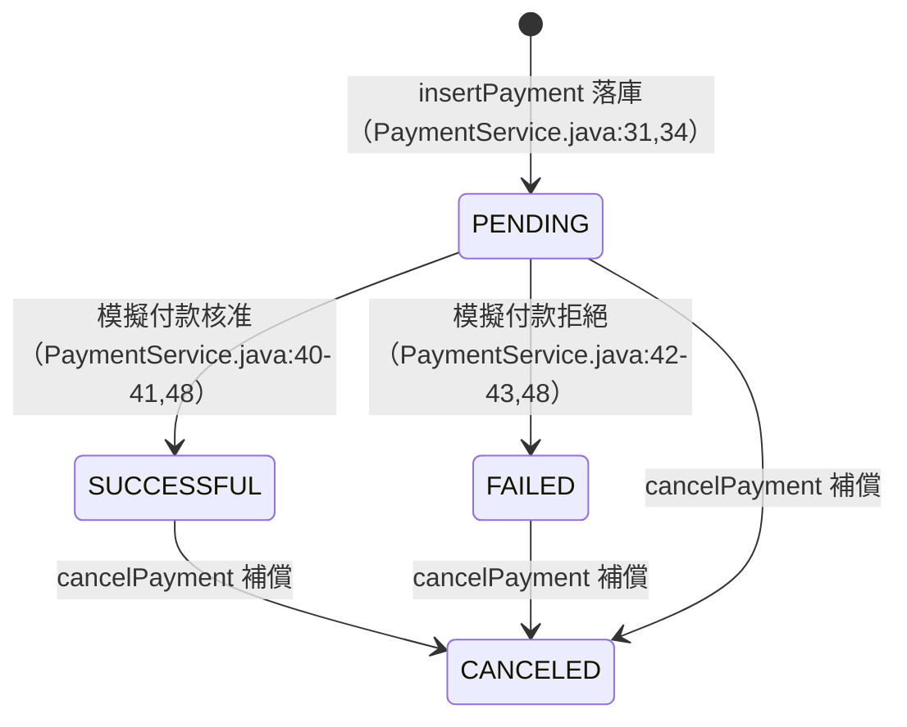

# 付款模組（PaymentService / PaymentsDAO）

> 分析基準：`software-factory` 分支 @ `975bb43`。所有陳述以現行程式碼為準，
> 附「檔案:行號」證據；若文件與實作不符，**以程式碼為準**。
> ⚠️ 本模組的付款是**模擬**的（範例專案，無任何真實金流／支付閘道整合），
> 全文不得被解讀為真實刷卡流程的規格。

## 1. 模組定位

| 元件 | 檔案 | 職責 |
|---|---|---|
| `PaymentService` | `src/main/java/io/orkes/example/saga/service/PaymentService.java` | 建立付款（`createPayment`）、取消付款（`cancelPayment`）、模擬付款驗證（`makePayment`） |
| `PaymentsDAO` | `src/main/java/io/orkes/example/saga/dao/PaymentsDAO.java` | `payments` 表的寫入、狀態更新、按訂單取消、回讀 |
| `Payment`（狀態列舉） | `src/main/java/io/orkes/example/saga/pojos/Payment.java:7-12` | `PENDING`／`FAILED`／`SUCCESSFUL`／`CANCELED` |
| `make_payment` worker | `src/main/java/io/orkes/example/saga/workers/ConductorWorkers.java:62-82` | 正向步驟：呼叫 `createPayment` 並翻譯成 Conductor task 結果 |
| `cancel_payment` worker | `src/main/java/io/orkes/example/saga/workers/ConductorWorkers.java:149-163` | 補償步驟：呼叫 `cancelPayment` 並翻譯成 Conductor task 結果 |

`PaymentService` 將 DAO 連線字串寫死為 SQLite 檔 `food_delivery.db`
（`PaymentService.java:20`）；每次 DAO 操作各自開一條連線（`BaseDAO.java:20-26`）。
排程與補償的觸發順序由外部 Conductor server 上的 workflow 定義決定，
repo 內看不到（系統層級說明見 `docs/architecture.md`）。

**本文件回答的核心問題**：什麼情況會留下付款紀錄、什麼情況不會——這直接決定
補償步驟 `cancel_payment` 回 `COMPLETED`（查得付款）還是
`FAILED_WITH_TERMINAL_ERROR`（查無付款）。

## 2. 付款狀態機

狀態值共四種（`Payment.java:7-12`），DB 的 `status` 欄存列舉名文字
（`PaymentsDAO.java:26,44,60`）。

| 轉換 | 觸發點 | 是否落庫 | 證據 |
|---|---|---|---|
| （新）→ `PENDING` | `createPayment` 先以 `PENDING` 插入一列 | ✅ 有紀錄 | `PaymentService.java:26-34`、`PaymentsDAO.java:14-33` |
| `PENDING` → `SUCCESSFUL` | `makePayment` 模擬核准後的最後一次 UPDATE | ✅ 同一筆更新 | `PaymentService.java:40-42,48`、`PaymentsDAO.java:40-50` |
| `PENDING` → `FAILED`（模擬拒絕） | 到期日無效／已逾期 | ✅ 同一筆更新為 `FAILED` | `PaymentService.java:42-44,48` |
| （寫入失敗）→ 回傳 `FAILED` | INSERT 本身失敗 | ❌ **DB 無紀錄**（見 §3 分支 A） | `PaymentService.java:34-38,48` |
| 任何既有狀態 → `CANCELED` | `cancelPayment` 補償 | ✅ 該訂單**所有**付款一次轉 `CANCELED` | `PaymentsDAO.java:56-66` |

兩個與補償相關的細節：

- `cancelPaymentsByOrderId` 的 SQL 是 `UPDATE payments SET status='CANCELED'
  WHERE orderId=?`——**不過濾現行狀態**（`PaymentsDAO.java:57`），所以
  `PENDING`／`FAILED`／`SUCCESSFUL` 的紀錄都會被轉成 `CANCELED`；
  「模擬拒絕（`FAILED`）的付款」之後仍可被補償命中。
- 同一 `orderId` 可能有多筆付款（例如 worker 重試造成多次 `createPayment`），
  一次 `cancelPayment` 全部取消（`PaymentService.java:59-60`）。
  重複取消同一訂單仍會命中列並回傳受影響列數（冪等但非零）。

## 3. `createPayment` 的兩條失敗分支與補償影響

`createPayment` 的流程（`PaymentService.java:22-50`）：產生 UUID `paymentId` →
以 `PENDING` 插入 →（成功才）`makePayment` 模擬 → 最後 `updatePaymentStatus`
記錄終態。**兩條失敗分支的差別在「DB 有沒有留下紀錄」**：

| | 分支 A：付款紀錄寫入失敗 | 分支 B：模擬付款被拒絕 |
|---|---|---|
| 觸發條件 | INSERT 回報 SQLException（如主鍵衝突、寫入被中止）；連線本身正常 | INSERT 成功，`makePayment` 回 false（到期日無法解析或已逾期） |
| DB 付款紀錄 | ❌ **無**：一列都沒寫入；最後的 `updatePaymentStatus` 更新 0 列，是 no-op（`PaymentService.java:34-38,48`） | ✅ **有**：同一筆由 `PENDING` 更新為 `FAILED`（`PaymentService.java:40-44,48`） |
| 回傳 `Payment` | `status=FAILED`、`errorMsg="Payment creation failure"`；帶著僅存在於記憶體的 `paymentId` | `status=FAILED`、`errorMsg="Expired payment method:…"` 或 `"Invalid expiry date:…"` |
| `make_payment` worker | 非 `SUCCESSFUL` → `FAILED_WITH_TERMINAL_ERROR`，輸出帶 `error`（`ConductorWorkers.java:72-77`） | 同左 |
| 補償 `cancel_payment` 的結果 | `cancelPayment` 回 0 → `FAILED_WITH_TERMINAL_ERROR`（「查無付款」，不可重試；`ConductorWorkers.java:154-157`） | `cancelPayment` 回 ≥1（該 `FAILED` 列被轉 `CANCELED`）→ `COMPLETED`（`ConductorWorkers.java:158`） |

成功分支（`SUCCESSFUL`）的補償行為同分支 B：紀錄存在，`cancel_payment` 命中並回 `COMPLETED`。

**第三種情況不是分支 A**：若資料庫連線本身無法建立，`BaseDAO.connect()` 拋
`DataAccessException`（`BaseDAO.java:20-25`），`createPayment` 會直接拋出例外、
**不會**回傳帶 `"Payment creation failure"` 的 `Payment`——分支 A 只涵蓋
「連線正常但 INSERT 語句失敗」。DAO 層以回傳非空錯誤字串表達後者
（`PaymentsDAO.java:28-32`）。

## 4. 模擬付款的驗證範圍（非真實金流）

`makePayment`（`PaymentService.java:63-87`）是純模擬：

- **不呼叫任何外部支付服務**；原始碼註解直言跳過非同步呼叫、直接假設付款通過
  （`PaymentService.java:84-86`）。
- 只有 `PaymentMethod.type` **恰為 `"Credit Card"`** 時才檢查到期日
  （`PaymentService.java:64`）。
- 信用卡的檢查只有一項——**到期日**（`details.expiry`，格式 `MM/yyyy`）：
  - 無法解析：`errorMsg="Invalid expiry date:<原始值>"` → 拒絕（`PaymentService.java:70-75`）。
  - 已逾期（`today > expiry`）：`errorMsg="Expired payment method:<原始值>"` → 拒絕（`PaymentService.java:77-81`）。
  - 實作細節：解析結果取自該月**一日零時**，因此進入到期月份即判為逾期；月份超出
    1–12 依 JDK `SimpleDateFormat` 預設（lenient）進位。
- **其他付款方式（如 `Cash`）不做任何檢查、直接核准**（`PaymentService.java:63,86`）。
  卡號、CVV、金額在任何路徑上都不參與驗證。
- 「落庫」的 `method` 欄存的是 `PaymentMethod.toAuditString()`（Issue #83）：只有付款類型與
  卡號後四碼，例如 `Credit Card ****1111`。**不會**寫入完整卡號、到期日或 `cvv`
  （`PaymentsDAO.java:25`）。修正前存的是 Lombok `toString()` 的完整序列化，會把卡號與
  `cvv` 一併落庫；既有資料庫中的舊資料不會被自動清理。」

> ⚠️ 再次強調：上述驗證範圍刻意狹窄，屬教學用模擬。不得據本文件推論任何
> 真實金流的核准、拒付或退款行為。

## 5. `cancelPayment` 語意

`PaymentService.cancelPayment(orderId)` 直接把 DAO 的回傳值原封不動交給 worker
（`PaymentService.java:58-61`）。DAO 的 `cancelPaymentsByOrderId`
以單條 UPDATE 取消該訂單全部付款（`PaymentsDAO.java:56-66`）。

| 情況 | `cancelPayment` 回傳／行為 | `cancel_payment` worker 結果 |
|---|---|---|
| 該 `orderId` 有 ≥1 筆付款（任何狀態） | 受影響列數（≥1），全數轉 `CANCELED` | `COMPLETED`（`ConductorWorkers.java:158`） |
| 查無付款 | 回 `0`，**不拋錯**、不留下任何紀錄 | `FAILED_WITH_TERMINAL_ERROR`＋原因 `"No payment found for order …"`（不可重試；`ConductorWorkers.java:154-157`） |
| 資料庫失敗（連線或 UPDATE 出錯） | 拋 `DataAccessException` | `FAILED`＋原因（**可重試**；`ConductorWorkers.java:159-162`） |

三态區分的動機（`DataAccessException.java:3-10`、`PaymentsDAO.java:35-66`，Issue #34）：
補償必須能分辨「目標不存在」（終端錯誤，重試也沒有用）與「資料庫暫時不可用」
（可重試），而不是把兩者都當成成功。

## 6. 現有測試各保護哪一行為

### `PaymentServiceTest`（service 層，`src/test/java/io/orkes/example/saga/service/PaymentServiceTest.java`）

沿用寫死的 app DB（`food_delivery.db`）並以唯一 `orderId` 隔開情境（L23-31）：

| 測試 | 保護的行為 |
|---|---|
| `successfulCardPaymentIsRecordedAsSuccessful`（L68） | 有效信用卡 → 回傳 `SUCCESSFUL`、無 `errorMsg`，且 DB 落庫為 `SUCCESSFUL` |
| `expiredCardFailsWithReason`（L81） | 逾期到期日 → `FAILED`＋`"Expired payment method:…"`，且**失敗狀態也落庫**（協調器與補償才看得到紀錄） |
| `unparsableExpiryFailsWithReason`（L93） | 無法解析的日期 → `FAILED`＋`"Invalid expiry date:"` 前綴，落庫 `FAILED` |
| `nonCardMethodSkipsExpiryCheck`（L106） | 驗證範圍：`Cash` 完全不檢查到期日，直接核准（§4） |
| `cancelPaymentMarksExistingPaymentCancelled`（L117） | 補償：既有付款被轉 `CANCELED`，回傳 1 |
| `cancelPaymentOnUnknownOrderIsHarmless`（L129） | 補償邊界：查無付款回 0、不拋錯、不留紀錄（§5 第二列） |
| `insertFailureReturnsFailedPaymentAndLeavesNoRecord`（L173） | 分支 A：回 `FAILED`＋`"Payment creation failure"`，DB 零紀錄（含該 `paymentId` 因最後 UPDATE 為 no-op 而不落庫） |
| `insertFailureMakesCancelPaymentReturnTerminalError`（L192） | 分支 A 的補償後果：`cancelPayment` 回 0——worker 據此回 `FAILED_WITH_TERMINAL_ERROR` 的依據 |

### `PaymentsDAOTest`（DAO 層，`src/test/java/io/orkes/example/saga/dao/PaymentsDAOTest.java`）

使用暫時性的獨立 DB（L27-37）：

| 測試 | 保護的行為 |
|---|---|
| `insertPaymentPersistsAsPending`（L64） | 插入初始狀態 `PENDING` 成功（回傳空字串）、可依 `orderId` 回讀，含 `createdAt` |
| `updatePaymentStatusToSuccessful`（L82） | `PENDING → SUCCESSFUL` 更新回傳 1 列、回讀一致 |
| `updateUnknownPaymentReturnsZero`（L97） | 更新不存在的 `paymentId` 回 0（分支 A 最後一次 UPDATE 為 no-op 的機制） |
| `cancelPaymentsByOrderIdCancelsEveryPayment`（L107） | 同一訂單多筆付款**一次全部** `CANCELED`（回傳 2）——§2 多重付款細節 |
| `cancelPaymentsByOrderIdReturnsZeroForUnknownOrder`（L124） | 查無付款回 0，給 worker 回報終端錯誤的訊號 |
| `updatePaymentStatusToCancelledAsCompensation`（L131） | `SUCCESSFUL → CANCELED` 的補償更新路徑 |
| `duplicatePaymentIdIsRejectedWithError`（L148） | `insertPayment` 對主鍵衝突回傳**非空**錯誤（含 `PRIMARY KEY`）——分支 A 的觸發來源之一 |
| `paymentStatusSurvivesDatabaseRoundTrip`（L161） | 狀態列舉恰為四值，可經 DB 文字往返（§2 前提） |

worker 層的三態翻譯（`COMPLETED`／`FAILED_WITH_TERMINAL_ERROR`／`FAILED`）
由 `ConductorWorkersTest`（`make_payment` L159/L172、`cancel_payment` L271/L286/L301/L322）
保護，不在本文件展開。

## 7. 資料落庫格式

`payments` 表由 `BaseDAO.createPaymentsTable` 建表（`BaseDAO.java:121-136`；
啟動時 `SagaApplication.java:25` 建立）：

| 欄位 | 型別 | 寫入內容 |
|---|---|---|
| `paymentId` | text，PRIMARY KEY | UUID 字串（每次 `createPayment` 新產生，`PaymentService.java:23-27`） |
| `orderId` | text NOT NULL | 來自 `PaymentRequest` |
| `amount` | number NOT NULL | 來自 `PaymentRequest` |
| `method` | text | `PaymentMethod.toAuditString()`：類型＋卡號後四碼（`PaymentsDAO.java:25`）；不含完整卡號、到期日、`cvv`（Issue #83） |
| `status` | text | `Payment.Status.name()`：`PENDING`／`SUCCESSFUL`／`FAILED`／`CANCELED` |
| `createdAt` | TIMESTAMP NOT NULL | 插入當下時間（`PaymentsDAO.java:15-16,25`） |

注意：`errorMsg` **不落庫**（表無此欄），失敗原因只存在於回傳物件與
`make_payment` 的 task output；協調器要判失敗與否，靠的是 `status` 欄。

## 8. 範圍與維護

- 本文件僅新增 `docs/modules/payment.md`，不修改任何程式碼、測試、`conductor/**`
  或 `docs/architecture.md`。
- 內容對應的實作基準為上文 commit；行號引用若因後續改動漂移，以原始碼為準。
- 本文件不含任何卡號、憑證或客戶個資；測試樣板值僅以名稱提及，不重述其內容。
