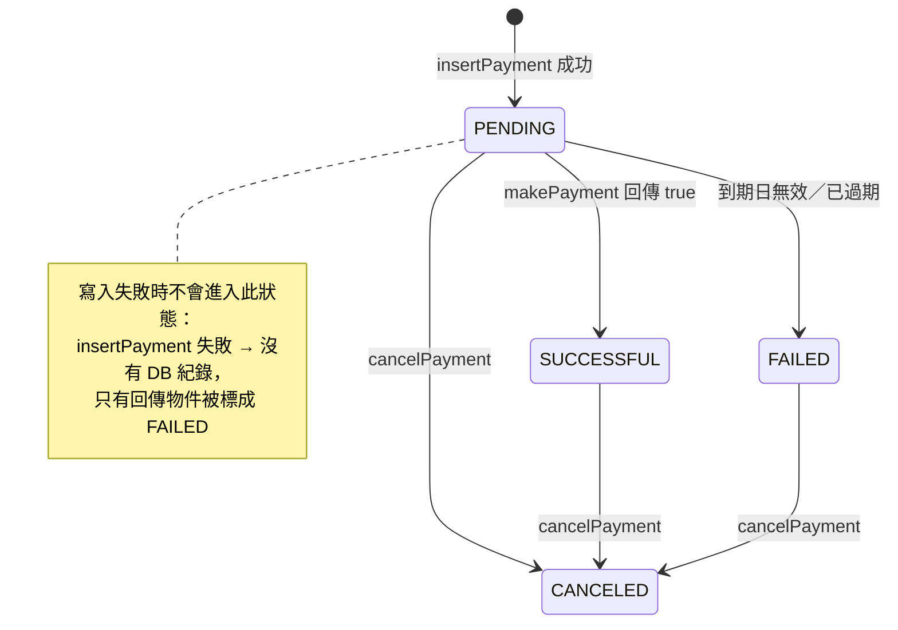

# 付款模組（Payment）

> 本文以目前 `software-factory` 分支上的實作為準，所有行為均附 `檔案:行號` 作為證據；
> 若程式碼與本文不一致，以程式碼為準。
>
> **這是模擬付款，不是真實金流。** `PaymentService.makePayment()` 只檢查信用卡到期日，
> 之後直接視為付款成功；沒有串接任何金流閘道、授權、請款或退款 API
> （`src/main/java/io/orkes/example/saga/service/PaymentService.java:63-87`）。

## 1. 範圍與元件

| 元件 | 位置 | 職責 |
| --- | --- | --- |
| `PaymentService` | `service/PaymentService.java:22-50` | 建立付款、決定 `SUCCESSFUL`／`FAILED`、寫回最終狀態 |
| `PaymentService.cancelPayment` | `service/PaymentService.java:52-61` | 補償：取消指定 `orderId` 的付款 |
| `PaymentsDAO.insertPayment` | `dao/PaymentsDAO.java:14-33` | 寫入一筆付款，成功回傳空字串，失敗回傳錯誤訊息 |
| `PaymentsDAO.updatePaymentStatus` | `dao/PaymentsDAO.java:35-50` | 依 `paymentId` 更新狀態，回傳受影響列數 |
| `PaymentsDAO.cancelPaymentsByOrderId` | `dao/PaymentsDAO.java:52-66` | 依 `orderId` 把所有付款改為 `CANCELED`，回傳受影響列數 |
| `make_payment` worker | `workers/ConductorWorkers.java:62-82` | 呼叫 `createPayment`，把結果轉成 Conductor task 狀態 |
| `cancel_payment` worker | `workers/ConductorWorkers.java:149-163` | 呼叫 `cancelPayment`，把回傳列數轉成 task 狀態 |

`payments` 資料表由 `BaseDAO.createPaymentsTable()` 建立
（`dao/BaseDAO.java:121-136`），欄位如下：

| 欄位 | 型別／限制 | 說明 |
| --- | --- | --- |
| `paymentId` | `text PRIMARY KEY` | 每次 `createPayment` 產生的 UUID |
| `orderId` | `text NOT NULL` | 所屬訂單；同一訂單可以有多筆付款 |
| `amount` | `number NOT NULL` | 由 `PaymentRequest.amount` 帶入 |
| `method` | `text` | `PaymentMethod.toString()` 的文字表示，非正規化欄位 |
| `status` | `text` | `Payment.Status` 的名稱 |
| `createdAt` | `TIMESTAMP NOT NULL` | 寫入當下的時間 |

`Payment.errorMsg` 只在回傳物件與 worker output 中使用，**不會寫入資料庫**
（`pojos/Payment.java:13-19`、`dao/BaseDAO.java:126-133`）。因此從 DB 只能讀到狀態，
讀不到失敗原因。

## 2. 付款狀態機

`Payment.Status` 只有四個值（`pojos/Payment.java:7-12`）：



| 轉換 | 觸發點 | 是否落庫 | 證據 |
| --- | --- | --- | --- |
| （無）→ `PENDING` | `createPayment` 先設 `PENDING`，再 `insertPayment` | 成功寫入才有 | `PaymentService.java:31-34`、`PaymentsDAO.java:18-27` |
| `PENDING` → `SUCCESSFUL` | `makePayment` 回傳 `true` | 是，`updatePaymentStatus` | `PaymentService.java:40-41,47-48` |
| `PENDING` → `FAILED` | `makePayment` 回傳 `false` | 是，`updatePaymentStatus` | `PaymentService.java:42-43,47-48` |
| 任何既有狀態 → `CANCELED` | `cancelPayment` → `cancelPaymentsByOrderId` | 是 | `PaymentService.java:58-60`、`PaymentsDAO.java:56-62` |

補充：

- `PENDING` 是**寫入時的初始狀態**；`insertPayment` 直接把 `payment.getStatus()` 寫入
  （`PaymentsDAO.java:26`）。
- 程式沒有在資料庫層加上狀態轉移限制；`cancelPaymentsByOrderId` 的 SQL 是
  `UPDATE payments SET status='CANCELED' WHERE orderId=?`，因此**不檢查原本狀態**，
  連 `FAILED` 的既有紀錄也會被改成 `CANCELED`（`PaymentsDAO.java:56-62`）。
- `createPayment` 的寫入與狀態更新是兩個獨立的 DB 連線、不是同一筆交易
  （`PaymentsDAO.java:20-27,43-46`）。若 `insertPayment` 成功、但
  `updatePaymentStatus` 發生 SQL 例外，`createPayment` 不會捕捉
  （`PaymentService.java:47-49`、`PaymentsDAO.java:47-49`），此時 DB 會留下
  `PENDING` 紀錄，呼叫端收到 `DataAccessException`。

## 3. `createPayment` 的兩條失敗分支

`createPayment` 先建立帶有新 `paymentId` 的 `Payment`、設為 `PENDING`，再嘗試寫入
（`PaymentService.java:22-34`）。接下來依寫入結果分成兩條路徑。

### 3.1 分支 A：付款紀錄寫入失敗

`PaymentsDAO.insertPayment` 捕捉 `SQLException` 後回傳 `e.getMessage()`；成功才回傳空字串
（`PaymentsDAO.java:28-32`）。`createPayment` 以「回傳值是否為空」判斷失敗
（`PaymentService.java:34-38`）：

1. `errorMsg` 設為固定字串 `Payment creation failure`。
2. `status` 設為 `FAILED`。
3. 接著仍會呼叫 `updatePaymentStatus`；正常的新增失敗下該 `paymentId` 沒有列，UPDATE
   命中 0 列，`createPayment` 也不檢查這個回傳值（`PaymentService.java:47-48`、
   `PaymentsDAO.java:41-46`）。
4. **該次 INSERT 沒有留下任何新紀錄**；回傳的 `Payment` 仍帶著本次嘗試的
   `paymentId` 與 `FAILED` 狀態。UUID 正常不重複，因此 DB 也沒有這個 `paymentId`；
   若極端發生 `paymentId` 主鍵重複，後續 UPDATE 可能命中既有同 id 的列，屬現行實作邊界。

任何 `INSERT` 的 `SQLException` 都會走到這條分支，包含主鍵重複、欄位約束失敗等。

### 3.2 分支 B：模擬刷卡失敗（紀錄已存在）

若 `insertPayment` 成功，代表 `payments` 已有一筆 `PENDING` 紀錄；接著
`makePayment` 回傳 `false` 時（`PaymentService.java:39-44`）：

1. `errorMsg` 會是 `Invalid expiry date:<原值>` 或 `Expired payment method:<原值>`。
2. `status` 設為 `FAILED`。
3. `updatePaymentStatus` 會把**同一筆既有紀錄**從 `PENDING` 更新為 `FAILED`。
4. **DB 有一筆 `FAILED` 的付款紀錄**，但 `errorMsg` 不入庫。

### 3.3 差異對補償的影響

`cancel_payment` worker 只看 `PaymentService.cancelPayment(orderId)` 的回傳列數
（`ConductorWorkers.java:149-163`），而 `cancelPayment` 只做
`UPDATE ... WHERE orderId=?`（`PaymentsDAO.java:56-62`）：

| 情境 | DB 是否有該 `orderId` 的付款 | `cancelPayment` 回傳 | `cancel_payment` task 結果 |
| --- | --- | --- | --- |
| 分支 A：寫入失敗 | 沒有 | `0` | `FAILED_WITH_TERMINAL_ERROR`，原因 `No payment found for order <orderId>` |
| 分支 B：模擬刷卡失敗 | 有，狀態 `FAILED` | 受影響列數（通常 `1`） | `COMPLETED`，該列被改為 `CANCELED` |
| 付款成功後才補償 | 有，狀態 `SUCCESSFUL` | 受影響列數（通常 `1`） | `COMPLETED`，該列被改為 `CANCELED` |
| 從來沒有付款紀錄 | 沒有 | `0` | `FAILED_WITH_TERMINAL_ERROR` |

也就是說：

- **寫入失敗**代表「根本沒有付款紀錄可取消」，補償會得到 terminal error，不可重試。
- **模擬刷卡失敗**代表「有一筆失敗的付款紀錄」，補償仍會把它取消並回 `COMPLETED`。
  這不是把失敗付款改回成功，而是把該筆紀錄的最終狀態改為 `CANCELED`。
- 同一 `orderId` 若有多筆付款，`cancelPaymentsByOrderId` 會一次全部更新，回傳的是
  **所有**受影響列數（`PaymentsDAO.java:52-66`）；只有完全查無資料才回 `0`。

`make_payment` worker 對上述兩條分支的處理相同：只要回傳狀態不是 `SUCCESSFUL`，
task 就回 `FAILED_WITH_TERMINAL_ERROR`，並把 `errorMsg` 放進 output 的 `error`
（`ConductorWorkers.java:72-77`）。差別發生在後續的 `cancel_payment`。

## 4. 模擬付款的驗證範圍

`makePayment` 的完整驗證邏輯如下（`PaymentService.java:63-87`）：

| 檢查 | 實作 | 結果 |
| --- | --- | --- |
| 付款方式是否為信用卡 | `Objects.equals(payment.getPaymentMethod().getType(), "Credit Card")` | 不是 `Credit Card` 時**跳過所有檢查**，直接回傳 `true` |
| 到期日能否解析 | 以 `SimpleDateFormat("MM/yyyy")` 解析 `PaymentDetails.expiry` | 丟出 `ParseException` → `errorMsg = "Invalid expiry date:<原值>"`、回傳 `false` |
| 是否已過期 | `today.getTime() > expiry.getTime()` | 已過期 → `errorMsg = "Expired payment method:<原值>"`、回傳 `false` |
| 卡號、CVV、金額、幣別 | 沒有檢查 | 不影響結果 |

因此：

- **只有 `Credit Card` 會檢查到期日。** 其他付款方式（例如測試使用的 `Cash`）即使帶了
  過期日期，也會直接核准（`PaymentServiceTest.java:104-113`）。
- `Credit Card` 的比對是精確字串比對；`credit card`、`CreditCard` 等寫法都**不會**進入
  到期日檢查。
- `MM/yyyy` 解析出的時間點是該月 1 日 00:00；比較用的是時間戳，所以實務上進入到期月
  （該月 1 日 00:00 之後）就會被視為過期（`today > expiry`）。
- 這裡沒有真實授權、請款、退款或餘額查詢；`makePayment` 在通過（或跳過）到期日檢查後
  直接 `return true`（`PaymentService.java:84-86`）。**不得把本模組的行為解讀為真實金流。**

## 5. `cancelPayment` 的語意

`PaymentService.cancelPayment(orderId)` 直接轉呼叫
`PaymentsDAO.cancelPaymentsByOrderId(orderId)`（`PaymentService.java:58-60`）：

- 執行 `UPDATE payments SET status='CANCELED' WHERE orderId=?`，一次取消同一訂單的
  **所有**付款（`PaymentsDAO.java:56-62`）。
- 回傳受影響的列數：查無付款回 `0`；有 `N` 筆就回 `N`。
- 查無付款不是例外，也不會變更任何資料列；此時回傳 `0`。
- 若 SQL 執行失敗，`PaymentsDAO` 會把 `SQLException` 包成 `DataAccessException` 拋出
  （`PaymentsDAO.java:63-65`），由 worker 決定 task 狀態。

`cancel_payment` worker 的映射（`ConductorWorkers.java:149-163`）：

| `cancelPayment` 結果 | Task 狀態 | 原因 |
| --- | --- | --- |
| 受影響列數 `> 0` | `COMPLETED` | 無 |
| `0` | `FAILED_WITH_TERMINAL_ERROR` | `No payment found for order <orderId>` |
| 丟出 `DataAccessException` | `FAILED`（可重試） | `Failed to cancel payment for order <orderId>: <資料庫訊息>` |

> 補償步驟的觸發順序與重試策略由 Conductor 上的 `FoodDeliveryWorkflow` 定義決定，
> 不在本 repo 內；本文只描述 worker 收到呼叫後的行為。

## 6. 現有測試各自保護什麼

### 6.1 `PaymentServiceTest`

位置：`src/test/java/io/orkes/example/saga/service/PaymentServiceTest.java`。

| 測試方法 | 行號 | 保護的行為 |
| --- | --- | --- |
| `successfulCardPaymentIsRecordedAsSuccessful` | `66-77` | 有效信用卡 → `SUCCESSFUL`、無 `errorMsg`、DB 也是 `SUCCESSFUL` |
| `expiredCardFailsWithReason` | `79-89` | 逾期卡 → `FAILED`、`errorMsg` 為 `Expired payment method:<原值>`、失敗狀態也要落庫 |
| `unparsableExpiryFailsWithReason` | `91-102` | 無法解析的到期日 → `FAILED`、`errorMsg` 以 `Invalid expiry date:` 開頭、狀態落庫 |
| `nonCardMethodSkipsExpiryCheck` | `104-113` | 非信用卡（`Cash`）帶過期日期仍直接核准為 `SUCCESSFUL` |
| `cancelPaymentMarksExistingPaymentCancelled` | `115-125` | 既有付款經 `cancelPayment` 回傳 `1`，DB 變成 `CANCELED` |
| `cancelPaymentOnUnknownOrderIsHarmless` | `127-137` | 查無付款時回傳 `0`、不拋錯、不留下紀錄 |
| `insertFailureReturnsFailedPaymentAndLeavesNoRecord` | `171-188` | 分支 A：`FAILED` ＋ `Payment creation failure`，DB 無 `orderId`／`paymentId` 紀錄 |
| `insertFailureMakesCancelPaymentReturnTerminalError` | `190-204` | 分支 A 後續：`cancelPayment` 回 `0`，對應 worker 的 `FAILED_WITH_TERMINAL_ERROR` 語意 |

### 6.2 `PaymentsDAOTest`

位置：`src/test/java/io/orkes/example/saga/dao/PaymentsDAOTest.java`。

| 測試方法 | 行號 | 保護的行為 |
| --- | --- | --- |
| `insertPaymentPersistsAsPending` | `62-78` | 寫入成功回傳空字串；初始狀態 `PENDING`；可依 `orderId` 回讀欄位與 `createdAt` |
| `updatePaymentStatusToSuccessful` | `80-93` | `PENDING` → `SUCCESSFUL` 回傳 `1`，回讀為 `SUCCESSFUL` |
| `updateUnknownPaymentReturnsZero` | `95-103` | 更新不存在的 `paymentId` 回傳 `0` |
| `cancelPaymentsByOrderIdCancelsEveryPayment` | `105-120` | 同一 `orderId` 的多筆付款一次全部改為 `CANCELED`，回傳 `2` |
| `cancelPaymentsByOrderIdReturnsZeroForUnknownOrder` | `122-127` | 查無付款時取消回傳 `0` |
| `updatePaymentStatusToCancelledAsCompensation` | `129-144` | 已成功的付款可被更新為 `CANCELED` |
| `duplicatePaymentIdIsRejectedWithError` | `146-157` | 重複 `paymentId` 的 `INSERT` 回傳非空錯誤，訊息含 `PRIMARY KEY` |
| `paymentStatusSurvivesDatabaseRoundTrip` | `159-166` | 四個狀態值可經名稱字串往返 |

> worker 層的 task 狀態映射另由 `ConductorWorkersTest` 覆蓋
> （`make_payment`：`158-181`；`cancel_payment`：`270-345`），本文不重複列舉。

## 7. 維護者驗證

文件變更後可用下列命令檢查是否誤入敏感資料（於 repo 根目錄執行）：

```bash
grep -nE '([0-9][ -]?){13,19}' docs/modules/payment.md
grep -nE '[[:alnum:]._%+-]+@[[:alnum:].-]+[.][[:alpha:]]{2,}' docs/modules/payment.md
grep -niE 'bearer [a-z0-9._-]{10,}|client[_-]secret|private[_-]key' docs/modules/payment.md
```

預期三條命令都沒有輸出。此文件為唯讀文件變更，不影響
`./gradlew test --no-daemon` 的結果。
