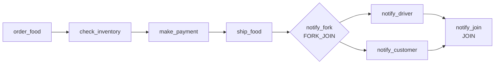

# Saga 編排層：workflow 定義與 worker 契約（TB4）

> 本文說明 **Saga 編排層目前的行為**：入庫的兩份 workflow 定義、9 個 worker 的
> 輸入／輸出與失敗語意，以及契約測試保護的範圍。
> 定義的來源、重建依據、設計決定與註冊紀錄見
> [`conductor/PROVENANCE.md`](../../conductor/PROVENANCE.md)；本文只描述行為，兩者互補。
> 若文件與程式碼或 `conductor/**` 的 JSON 不一致，以程式碼與 JSON 為準。

## 1. 編排層的組成

| 位置 | 內容 |
| --- | --- |
| `conductor/workflows/FoodDeliveryWorkflow.v1.json` | 主流程 `FoodDeliveryWorkflow`（version 1）；成功路徑與 `failureWorkflow` 的掛載點 |
| `conductor/workflows/FoodDeliveryFailureWorkflow.v1.json` | 補償流程 `FoodDeliveryFailureWorkflow`（version 1）；不看失敗點，一律反向執行冪等的取消 |
| `conductor/taskdefs/*.json` | 9 個 task 的 `TaskDef`：重試次數、重試間隔、timeout 與 input／output keys |
| `src/main/java/io/orkes/example/saga/workers/ConductorWorkers.java` | 9 個 `@WorkerTask` 的實作；task 名稱、輸入 POJO、輸出 key 與狀態語意的程式碼端 |
| `src/main/java/io/orkes/example/saga/service/WorkflowService.java` | 啟動 `FoodDeliveryWorkflow` v1、組裝 10 個起始輸入、設定 task domain |

啟動路徑是：`POST /triggerFoodDeliveryFlow` → `WorkflowService.startFoodDeliveryWorkflow` →
Conductor server 以名稱 `FoodDeliveryWorkflow`、version `1` 啟動 workflow。
`WorkflowService` 固定 `correlationId = "api-triggered"`；若 `conductor.worker.all.domain`
非空，會把 `taskToDomain["*"]` 設為該值（`application.properties` 的預設值為 `saga`）。
9 個 worker 由 `@WorkerTask` 註冊；worker 端由 `conductor.worker.all.domain` 決定輪詢的
domain（`application.properties` 的預設值為 `saga`），與啟動請求的 `taskToDomain` 對齊。

`conductor/**` 是版控內的權威定義；註冊到 Orkes 與 server 讀回比對的紀錄見
`PROVENANCE.md` §2、§7。本文不重複那些來源紀錄。

## 2. 主流程

### 2.1 起始輸入（10 個 key）

`WorkflowService` 從 `FoodDeliveryRequest` 取下列 10 個欄位放入 workflow input，
`FoodDeliveryWorkflow.v1.json` 的 `inputParameters` 也正好宣告這 10 個 key：

| workflow input key | 來源（`FoodDeliveryRequest`） |
| --- | --- |
| `customerEmail` | `customerEmail` |
| `customerName` | `customerName` |
| `customerContact` | `customerContact` |
| `restaurantId` | `restaurantId` |
| `foodItems` | `foodItems` |
| `additionalNotes` | `additionalNotes` |
| `address` | `address` |
| `deliveryInstructions` | `deliveryInstructions` |
| `paymentAmount` | `paymentAmount` |
| `paymentMethod` | `paymentMethod` |

### 2.2 步驟順序



`notify_fork` 的兩個分支是平行執行；`notify_join` 的 `joinOn` 同時等待
`notify_driver_ref` 與 `notify_customer_ref`，兩者都完成後 workflow 才繼續計算輸出。

### 2.3 各步驟的輸入來源與輸出

| 順序 | Task（`taskReferenceName`） | 類型 | `inputParameters`（JSON key ← 來源） | worker 輸出 |
| --- | --- | --- | --- | --- |
| 1 | `order_food`（`order_food_ref`） | SIMPLE | `orderId` ← `workflow.workflowId`（#137）<br>`customerEmail` ← `workflow.input.customerEmail`<br>`customerName` ← `workflow.input.customerName`<br>`customerContact` ← `workflow.input.customerContact`<br>`restaurantId` ← `workflow.input.restaurantId`<br>`items` ← `workflow.input.foodItems`<br>`notes` ← `workflow.input.additionalNotes`<br>`deliveryAddress` ← `workflow.input.address`<br>`deliveryInstructions` ← `workflow.input.deliveryInstructions` | `orderId` |
| 2 | `check_inventory`（`check_inventory_ref`） | SIMPLE | `restaurantId` ← `workflow.input.restaurantId`<br>`items` ← `workflow.input.foodItems` | 無 |
| 3 | `make_payment`（`make_payment_ref`） | SIMPLE | `orderId` ← `order_food_ref.output.orderId`<br>`amount` ← `workflow.input.paymentAmount`<br>`method` ← `workflow.input.paymentMethod` | 成功：`orderId`、`paymentId`、`paymentStatus`<br>失敗：另含 `error` |
| 4 | `ship_food`（`ship_food_ref`） | SIMPLE | `orderId` ← `order_food_ref.output.orderId`<br>`deliveryAddress` ← `workflow.input.address`<br>`deliveryInstructions` ← `workflow.input.deliveryInstructions` | 成功：`driverId`<br>失敗：無輸出 |
| 5 | `notify_fork`（`notify_fork_ref`） | FORK_JOIN | 無 | 無（分支如下） |
| 5a | `notify_driver`（`notify_driver_ref`） | SIMPLE | `orderId` ← `order_food_ref.output.orderId`<br>`driverId` ← `ship_food_ref.output.driverId`<br>`dropOff` ← `workflow.input.address` | 空 Map |
| 5b | `notify_customer`（`notify_customer_ref`） | SIMPLE | `orderId` ← `order_food_ref.output.orderId`<br>`customerEmail` ← `workflow.input.customerEmail`<br>`customerName` ← `workflow.input.customerName` | `orderId`、`notified=false` |
| 6 | `notify_join`（`notify_join_ref`） | JOIN | `joinOn`：`notify_driver_ref`、`notify_customer_ref` | 無 |

各步驟實際做的事：

- **`order_food`**：呼叫 `OrderService.createOrder`，以 `workflowId` 作為 `orderId`
  （`OrderRequest.orderId` ← `workflow.workflowId`；未提供時 `createOrder` 才自行產生 UUID），
  先建立或重用 `customers`，再寫入 `orders` 與 `orders_details`，訂單初始狀態為
  `PENDING`。成功時輸出 `orderId`（等於 `workflowId`）。這是 #137 的修正：`order_food`
  逾時而訂單已建立時，補償 workflow 仍能以 `workflowId` 取消訂單。
  `deliveryInstructions` 雖有綁定，但 `OrderService.createOrder` 沒有把它寫入資料庫。
- **`check_inventory`**：呼叫 `InventoryService.checkAvailability`，依 `restaurantId`
  讀取 `restaurants`；目前語意是「餐廳是否存在」（名稱非空），**不檢查也不保留食材庫存**，
  `items` 參數沒有被使用。成功時沒有輸出，下游只依 task 狀態繼續。
- **`make_payment`**：呼叫 `PaymentService.createPayment`，先嘗試寫入一筆 `payments`
  （狀態 `PENDING`），再執行模擬付款並更新狀態。成功時輸出 `orderId`、`paymentId`、
  `paymentStatus=SUCCESSFUL`；失敗時另外把錯誤訊息放在 `error`。
  `PaymentRequest.customerId` 沒有對應的 JSON input，`PaymentService` 也沒有使用它。
- **`ship_food`**：呼叫 `ShipmentService.createShipment`，隨機指派司機、寫入
  `shipments`，成功時把 shipment 設為 `CONFIRMED` 並輸出 `driverId`；失敗時不輸出
  `driverId`，避免下游拿到未指派的司機。
- **`notify_driver`／`notify_customer`**：兩者都是 placeholder，**不實際寄送通知**；
  詳細行為見 §4.6。
- **`notify_join`**：只負責等待兩個通知分支；本身沒有輸入或輸出。

主 workflow 的 `outputParameters` 如下：

| workflow output | 來源 |
| --- | --- |
| `orderId` | `${order_food_ref.output.orderId}` |
| `paymentId` | `${make_payment_ref.output.paymentId}` |
| `paymentStatus` | `${make_payment_ref.output.paymentStatus}` |
| `driverId` | `${ship_food_ref.output.driverId}` |

### 2.4 有綁定但沒有生產者的欄位

下列 POJO 欄位存在，但目前的 workflow 定義沒有提供來源，程式也沒有使用；閱讀或修改
契約時不要假設它們有值：

| POJO | 欄位 | 現況 |
| --- | --- | --- |
| `PaymentRequest` | `customerId` | JSON 沒有提供；`PaymentService` 未使用 |
| `DriverNotificationRequest` | `pickUp` | JSON 沒有提供；`notify_driver` 目前是空實作 |

## 3. 補償流程

### 3.1 觸發條件

主 workflow 的根層宣告：

```json
"failureWorkflow": "FoodDeliveryFailureWorkflow"
```

當主 workflow 進入 `FAILED` 終態時，Conductor 會啟動 `FoodDeliveryFailureWorkflow`。
單一 task 的 `FAILED` 會先依該 task 的 `TaskDef` 重試（見 §4.5）；重試耗盡或遇到
`FAILED_WITH_TERMINAL_ERROR` 後，workflow 才失敗並進入補償。

補償 workflow 宣告的輸入如下。這些欄位由 Conductor 啟動 failure workflow 時帶入，
不是 `WorkflowService` 直接放進去的：

| 輸入 | 內容 |
| --- | --- |
| `workflowId` | 失敗的主 workflow id |
| `reason` | 失敗原因 |
| `failureStatus` | 失敗狀態；目前只在 `inputParameters` 宣告，沒有 task 引用 |
| `failedWorkflow` | 失敗的主 workflow 物件，內含 `output`、`tasks`、`failedReferenceTaskNames` |
| `customerEmail` | 原 workflow 的客戶 email；`PROVENANCE.md` §7 的 server 實測確認補償輸入含此值 |
| `customerName` | 原 workflow 的客戶姓名；同上 |

補償 workflow 的步驟是：`extract_failure_context`（JSON_JQ_TRANSFORM）→
`cancel_delivery` → `cancel_payment` → `cancel_order` → `notify_customer`，
四個都是 SIMPLE，依序執行。

### 3.2 取出失敗上下文

`extract_failure_context` 的 `queryExpression` 是：

```jq
{ orderId: (.parent.output.orderId // first(.parent.tasks[]? | select(.referenceTaskName == "order_food_ref") | .outputData.orderId) // .parent.workflowId), failedTaskName: .parent.failedReferenceTaskNames[0] }
```

其中 `parent` 是 `${workflow.input.failedWorkflow}`。這個表達式做兩件事：

1. **`orderId`**：依序取主 workflow `output.orderId`、`tasks` 裡 `order_food_ref` 的
   `outputData.orderId`、最後是 `parent.workflowId`（新增，#137）。第三個來源是關鍵：
   `order_food` 逾時時前兩者都取不到，但訂單可能已以 `workflowId` 建立。
2. **`failedTaskName`**：取 `failedReferenceTaskNames[0]`，**只用於診斷**，不再決定補償內容
   （#136–#139）。

`JSON_JQ_TRANSFORM` 的輸出會包在 `result` 底下，因此下游運算式是
`${extract_failure_context_ref.output.result.orderId}` 與
`${extract_failure_context_ref.output.result.failedTaskName}`。

### 3.3 補償內容：不看失敗點，一律反向取消

補償 workflow **沒有 SWITCH**。#136–#139 之前它以 `failedReferenceTaskNames[0]` 選分支，
但該集合是 Java `HashSet`、含已被重試的失敗嘗試、且不含 `TIMED_OUT` 的 task，因此會選錯分支
或什麼都不補償（反例見 `specs/saga.qnt` 的 `saga_switch`）。

現行做法：依正向步驟的反序，一律執行

| 順序 | 補償 task | 帶入 | 為什麼不需要判斷 |
| --- | --- | --- | --- |
| 1 | `cancel_delivery` | `orderId`、`allowMissing=true` | 沒有外送單時是 no-op |
| 2 | `cancel_payment` | `orderId`、`allowMissing=true` | 沒有付款時是 no-op |
| 3 | `cancel_order` | `orderId`、`allowMissing=true` | 沒有訂單時是 no-op |

最後執行 `notify_customer`（`notify_customer_failure_ref`），帶入 `orderId`、
`customerEmail`、`customerName`，用來通知失敗；此步驟同樣是 placeholder，
**不實際寄送通知**（見 §4.6）。

`allowMissing=true` 讓 `cancel_*` 在「影響 0 列」時回 `COMPLETED` 而不是終端錯誤（§4.3）。
這消除了「補償取消不存在的資料而中斷」這類缺陷（`ab60ba5` 修掉的是其中一例）。
代價是補償會對從未建立的資料發出取消，日誌上多幾筆 no-op。

### 3.4 `ship_food` 失敗時的出貨單

`ShipmentService.createShipment` 在黑名單路徑上自行處理外送單：

- `insertShipment` 失敗時，資料庫沒有建立 shipment。
- shipment 建立後若找不到可用司機，`createShipment` 會先呼叫
  `shipmentDAO.cancelShipment(orderId)` 把該筆 shipment 標為 `CANCELED`，再回傳 `0`。
- **但**若 `confirmShipment` 拋出 `DataAccessException`，shipment 會停在 `SCHEDULED`
  而沒有任何地方取消它（#139 缺陷 D）。

現行補償一律執行 `cancel_delivery`，最後一種情況因此被涵蓋；前兩種情況則由
`allowMissing` 視為 no-op。`ShipmentService` 不再需要額外的自我清理。

### 3.5 補償的實際效果與限制

| 補償 task | 實際動作 | 不是什麼 |
| --- | --- | --- |
| `cancel_payment` | 把同一 `orderId` 的**所有** `payments` 列狀態改為 `CANCELED` | 不退款、不呼叫金流、不刪除付款紀錄 |
| `cancel_delivery` | 把同一 `orderId` 的 `shipments` 列狀態改為 `CANCELED` | 不處理司機端狀態、不刪除外送單 |
| `cancel_order` | 把 `orders.status` 改為 `CANCELLED` | 不刪除 `orders_details`、不回滾 `customers` |

補償是**狀態補償**，不是資料刪除或資料庫交易回滾。補償 task 的回傳狀態與重試設定
決定後續行為：資料庫例外回 `FAILED`（可重試），查無目標且未帶 `allowMissing` 時回
`FAILED_WITH_TERMINAL_ERROR`（不重試）；三個 `cancel_*` 的 `retryCount` 都是 `3`
（見 §4.5）。補償 workflow 本身沒有額外宣告 `onFailure`，重試耗盡後的最終狀態由
Conductor 的 workflow 語意決定。

補償 workflow 仍可能因基礎設施故障而失敗（資料庫例外重試耗盡）。`specs/saga.qnt` 把
這點寫成不變量 `inv_compensation_failure_only_from_env`：補償失敗只允許由環境故障造成，
設計錯誤造成的失敗則視為缺陷。

## 4. 9 個 worker 的職責與失敗語意

### 4.1 正向 worker

| Task | 方法 | 職責／副作用 | `COMPLETED` | 失敗語意 |
| --- | --- | --- | --- | --- |
| `order_food` | `orderFoodTask` | `OrderService.createOrder`：建立／重用 customer，寫入 `orders`、`orders_details`；訂單狀態 `PENDING` | 輸出 `orderId` | `FAILED`；不設 `reasonForIncompletion`；失敗時 output 為空（`output.put("orderId", null)` 沒有掛到 `TaskResult`） |
| `check_inventory` | `checkInventoryTask` | `InventoryService.checkAvailability`：讀 `restaurants`，只判斷餐廳是否存在；`items` 未使用 | 無輸出 | `FAILED_WITH_TERMINAL_ERROR`，原因 `Restaurant is closed` |
| `make_payment` | `makePaymentTask` | `PaymentService.createPayment`：寫入付款、模擬付款、更新狀態；**不呼叫真實金流** | 輸出 `orderId`、`paymentId`、`paymentStatus=SUCCESSFUL` | `FAILED_WITH_TERMINAL_ERROR`；output 含 `paymentStatus=FAILED` 與 `error`（例如 `Expired payment method:<expiry>`、`Invalid expiry date:<expiry>`、`Payment creation failure`）；原因放在 output，不在 `reasonForIncompletion` |
| `ship_food` | `shipFoodTask` | `ShipmentService.createShipment`：隨機指派司機、寫入 `shipments`；成功時 `CONFIRMED` | 輸出 `driverId` | `FAILED`；不輸出 `driverId`；不設 `reasonForIncompletion`；司機不可用時 `ShipmentService` 已在內部取消該 shipment |

### 4.2 通知 worker

| Task | 方法 | 行為 | 狀態／輸出 |
| --- | --- | --- | --- |
| `notify_driver` | `checkForDriverNotifications` | **空實作**；不寄送任何通知 | 永遠 `COMPLETED`，輸出空 Map |
| `notify_customer` | `checkForCustomerNotifications` | **placeholder**；不寄送 email／通知 | 永遠 `COMPLETED`，輸出 `orderId`、`notified=false` |

兩個通知 worker 都回傳 `Map` 而不是 `TaskResult`；Conductor SDK 會把 `Map` 回傳值
放進 output 並標成 `COMPLETED`。目前它們沒有任何失敗分支，所以這兩個 task 不會因為
「通知失敗」而讓 workflow 失敗。

### 4.3 補償 worker

| Task | 方法 | 補償動作 | `COMPLETED` | 失敗語意 |
| --- | --- | --- | --- | --- |
| `cancel_payment` | `cancelPaymentTask` | `PaymentService.cancelPayment`：同一 `orderId` 的所有付款改為 `CANCELED` | 受影響列數 > 0，或 `allowMissing=true` | 未帶 `allowMissing` 且查無付款 → `FAILED_WITH_TERMINAL_ERROR`，原因 `No payment found for order <orderId>`；資料庫例外 → `FAILED`，原因含 `Failed to cancel payment for order <orderId>: <message>` |
| `cancel_delivery` | `cancelDeliveryTask` | `ShipmentService.cancelDelivery`：同一 `orderId` 的 shipment 改為 `CANCELED` | 受影響列數 > 0，或 `allowMissing=true` | 未帶 `allowMissing` 且查無外送單 → `FAILED_WITH_TERMINAL_ERROR`，原因 `No shipment found for order <orderId>`；資料庫例外 → `FAILED` |
| `cancel_order` | `cancelOrderTask` | `OrderService.cancelOrder`：`orders.status` 改為 `CANCELLED` | 受影響列數 > 0，或 `allowMissing=true` | 未帶 `allowMissing` 且查無訂單 → `FAILED_WITH_TERMINAL_ERROR`，原因 `No order found for order <orderId>`；資料庫例外 → `FAILED` |

三個補償 worker 共用同一個流程（`ConductorWorkers.cancel`），都回傳 `TaskResult`，
失敗原因一律寫入 `reasonForIncompletion`。`orderId` 空白時一律回
`FAILED_WITH_TERMINAL_ERROR`，即使帶了 `allowMissing`：沒有 id 就無從判斷是否真的已取消。

### 4.4 狀態語意

`TaskResult.Status` 的三種狀態在 Conductor 的意義：

| 狀態 | 意義 | 後續 |
| --- | --- | --- |
| `COMPLETED` | 成功 | 繼續下一個 task；成功 output 供下游引用 |
| `FAILED` | 可重試的失敗 | Conductor 依 `TaskDef.retryCount`／`retryDelaySeconds` 重試；`retryCount=0` 表示不重試，重試耗盡後 workflow 失敗 |
| `FAILED_WITH_TERMINAL_ERROR` | 不可重試的失敗 | 不重試，task 直接失敗，workflow 進入失敗與補償 |

`failureWorkflow` 的觸發點是**整個 workflow 失敗**，不是單一 task 第一次回 `FAILED`；
重試先由 `TaskDef` 處理。

### 4.5 TaskDef 的重試與 timeout

| Task | `retryCount` | 其他設定 |
| --- | --- | --- |
| `order_food` | `0` | 非冪等寫入，不重試 |
| `check_inventory` | `3` | 唯讀；但預期的「餐廳不存在」是 terminal error，不會重試 |
| `make_payment` | `0` | 非冪等寫入，不重試 |
| `ship_food` | `0` | 非冪等寫入，不重試 |
| `notify_driver` | `0` | 空實作 |
| `notify_customer` | `0` | placeholder |
| `cancel_payment` | `3` | 冪等 UPDATE；資料庫例外可重試 |
| `cancel_delivery` | `3` | 冪等 UPDATE；資料庫例外可重試 |
| `cancel_order` | `3` | 冪等 UPDATE；資料庫例外可重試 |

9 個 TaskDef 共同的設定是 `retryLogic: FIXED`、`retryDelaySeconds: 10`、
`timeoutSeconds: 300`、`responseTimeoutSeconds: 60`、`timeoutPolicy: TIME_OUT_WF`。
重試與 timeout 的設計理由（非冪等 vs 冪等、保守預設）見 `PROVENANCE.md` §4。

### 4.6 非真實行為（重要）

以下行為容易被誤讀成「已經做了」，文件與程式都明確標示其實際語意：

- **`notify_driver` 不寄送通知**：方法回傳空 Map，沒有任何司機通知實作。
- **`notify_customer` 不寄送通知**：方法只回傳 `orderId` 與 `notified=false`；
  主流程與補償流程都使用同一個 worker，因此兩處都不會真的通知客戶。
- **`make_payment` 是模擬付款**：`PaymentService.makePayment` 只在信用卡類型時檢查
  到期日，之後直接視為成功；不會呼叫金流服務、不會實際扣款。
- **`check_inventory` 不是庫存檢查**：只判斷餐廳是否存在，不檢查食材數量、也不保留庫存。

## 5. 契約測試保護什麼

`src/test/java/io/orkes/example/saga/workers/WorkflowDefinitionContractTest.java`
把 `conductor/**` 的 JSON 與 `ConductorWorkers`／`WorkflowService` 的程式碼綁在一起。
它不連線 Conductor server，也不需要憑證；測試會直接讀版控內的 JSON，並以反射與
實際呼叫 `WorkflowService` 取得程式碼端事實。

### 5.1 7 項檢查

| # | 檢查 | 保護的契約 |
| --- | --- | --- |
| 1 | 每個 `type: SIMPLE` 的 task `name` 都有對應的 `@WorkerTask` | JSON 不會引用不存在的 worker |
| 2 | 每個 `@WorkerTask` 都被某個 workflow 使用，且 `conductor/taskdefs/` 有同名檔案、`name` 欄位一致 | 沒有孤兒 worker、沒有漏掉的 TaskDef |
| 3 | 同一 workflow 內 `taskReferenceName` 不重複（含 FORK 分支） | 下游 `${ref.output...}` 不會指向錯誤的 task |
| 4 | 每個 SIMPLE task 的 `inputParameters` key 都是該 worker 參數 POJO 的欄位 | JSON 不會傳入 worker 不認得的欄位 |
| 5 | 每個 `${...}` 都解析得到：`workflow.input` key 對 `WorkflowService` 的實際起始輸入（failure workflow 則對自身宣告的 `inputParameters`）；`<ref>.output.<key>` 對 worker 實際輸出；JQ 的 `result.<key>` 對 `queryExpression` 產出的欄位。白名單 `workflow.workflowId` 是 Conductor 執行期屬性 | 沒有斷掉的輸入／輸出引用 |
| 6 | 補償 workflow 若有 SWITCH，每個分支名稱都是主 workflow 真實存在的 `taskReferenceName`（現行定義已無 SWITCH） | 補償分支不會因 ref 改名而失效 |
| 7 | `WorkflowService` 啟動的名稱與版本，和 JSON 定義的 `name`、`version` 一致 | 應用不會啟動到錯誤的定義版本 |

第 5 項的 worker 輸出 key 是從 `ConductorWorkers.java` 原始檔解析
`output.put(...)`／`result.put(...)` 取得；測試會先比對原始檔解析出的 `@WorkerTask`
名稱全集與位元組碼上的 annotation，解析器跟不上程式碼寫法時會直接紅燈，不會沉默漏檢。

### 5.2 負面測試

除了 7 項檢查，測試類別另有 4 個負面測試，故意注入違規並確認檢查會指出問題：

1. 把 SIMPLE task 名稱改成不存在的 worker → 檢查 1 失敗並指出名稱與 ref。
2. 把 `outputParameters` 改成引用不存在的 worker 輸出 key → 檢查 5 失敗並指出該 key。
3. 把 JQ 的 `result` 引用改成不存在的欄位 → 檢查 5 失敗並列出實際欄位。
4. 把 JQ 的 `queryExpression` 改成解析不出欄位的形式 → 檢查 5 回報，而不是略過。

### 5.3 不涵蓋的範圍

- **不連線 Conductor server**：不驗證 server 上的定義是否與 repo 相同；server 註冊與
  讀回比對屬 `PROVENANCE.md` §7 的紀錄，不是這個測試的職責。
- **不執行 workflow**：不驗證 task 的實際執行順序、retry/timeout 計時、FORK/JOIN 的
  runtime 行為，也不做需要外部服務的 E2E。
- **不驗證業務補償是否正確**：它只驗證 JSON 與程式碼的接縫；worker 行為由
  `ConductorWorkersTest` 等單元測試涵蓋。

### 5.4 修改定義時要跑什麼

| 變更 | 必跑測試 |
| --- | --- |
| `conductor/workflows/**` 或 `conductor/taskdefs/**` | `WorkflowDefinitionContractTest`；提交前再跑完整測試 |
| `ConductorWorkers` 的 task 名稱、參數 POJO、output key 或狀態語意 | `WorkflowDefinitionContractTest`、`ConductorWorkersTest`；提交前再跑完整測試 |
| `WorkflowService` 的啟動名稱／版本／起始輸入 key | `WorkflowDefinitionContractTest`、`WorkflowServiceTest`；提交前再跑完整測試 |

```bash
# 只跑定義契約測試
./gradlew test --no-daemon --tests 'io.orkes.example.saga.workers.WorkflowDefinitionContractTest'

# 提交前的完整測試（CI 也執行完整測試）
./gradlew test --no-daemon
```

修改定義時，除了讓測試綠燈，也要同步更新本文的步驟、I/O 與補償表格；若重試或 timeout
改變，更新 §4.5。

## 6. 與 `conductor/PROVENANCE.md` 的分工

| 文件 | 回答的問題 | 內容 |
| --- | --- | --- |
| `conductor/PROVENANCE.md` | 這份定義**從哪裡來**、為何重建、哪些是推論、註冊到哪個 server、雜湊是多少 | 來源紀錄與設計決定 |
| 本文 | 這份定義**現在怎麼運作**：步驟、I/O、失敗語意、補償分支、契約測試 | 行為說明 |

兩者互補：`PROVENANCE.md` 不描述行為，本文不重新記錄來源。若行為與文件不一致，
以程式碼與 `conductor/**` 的 JSON 為準；若來源、註冊事實或檔案雜湊改變，更新
`PROVENANCE.md`；若行為改變，更新本文。
